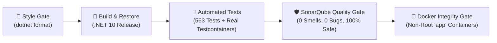

# 🎬 ShuffleSeries.Microservices

ShuffleSeries is a distributed, high-performance, and resilient microservices platform designed to provide smart, randomized content selection ("shuffle") across movies, series, and standalone episodes (such as *Black Mirror* or *Love, Death & Robots*).

Built with **.NET 10** and **C# 14**, the platform adheres to **Clean Architecture (Onion Architecture)**, **Domain-Driven Design (DDD)**, **CQRS**, and **Event-Driven Architecture**.

---

## 🏛️ System Architecture

The following diagram illustrates the high-level architecture and communication patterns across ShuffleSeries services:

```mermaid
flowchart TD
    Client["📱 Web & Mobile Clients"] -->|"HTTPS / REST"| Gateway["🚪 ShuffleSeries.ApiGateway\n(YARP, Rate Limiting, Auth)"]

    Gateway -->|"Reverse Proxy"| Identity["🔑 Identity Service\n(Auth, Guest Sessions, SSO)"]
    Gateway -->|"Reverse Proxy"| Catalog["📦 Catalog Service\n(Movies, Series, Platforms, Moods)"]
    Gateway -->|"Reverse Proxy"| Shuffle["🎲 Shuffle Engine Service\n(In-Memory Roulette & Swipe)"]
    Gateway -->|"Reverse Proxy"| Library["📚 User Library Service\n(Watchlist, Watched, Ratings)"]
    Gateway -->|"Reverse Proxy"| Gamification["🎟️ Tickets, Gamification & IAP\n(Streak, XP, Boiling Frog, Premium)"]
    Gateway -->|"Reverse Proxy"| Profile["👤 Profile & Preferences\n(PostgreSQL JSONB)"]
    Gateway -->|"Reverse Proxy"| Search["🔍 Search Service\n(Elasticsearch Engine)"]
    Gateway -->|"Reverse Proxy"| History["📊 History & Analytics\n(Swipe Telemetry, Watch History)"]
    Gateway -->|"Reverse Proxy"| Notification["🔔 Notification Service\n(Push, Email & Retention)"]

    Catalog -->|"Transactional Outbox"| RabbitMQ["📨 RabbitMQ (Event Bus)"]
    Identity -->|"Transactional Outbox"| RabbitMQ
    Library -->|"Transactional Outbox"| RabbitMQ
    Gamification -->|"Transactional Outbox"| RabbitMQ
    Profile -->|"Transactional Outbox"| RabbitMQ

    RabbitMQ -->|"Subscribe (InBox)"| Shuffle
    RabbitMQ -->|"Subscribe (InBox)"| Search
    RabbitMQ -->|"Subscribe (InBox)"| Gamification
    RabbitMQ -->|"Subscribe (InBox)"| History
    RabbitMQ -->|"Subscribe (InBox)"| Notification

    Shuffle -->|"In-Memory Cache & Sets"| Redis[("⚡ Redis (Cache & Token Blacklist)")]
    Gateway -->|"Verify Token Blacklist (Edge)"| Redis
    Identity -->|"Write Revoked Tokens & Timestamps"| Redis
    Catalog -->|"Read/Write"| PostgresCatalog[("🐘 PostgreSQL (Catalog)")]
    Library -->|"Read/Write"| PostgresLibrary[("🐘 PostgreSQL (Library)")]
    Profile -->|"Read/Write"| PostgresProfile[("🐘 PostgreSQL (Profile)")]
    Search -->|"Search Index"| Elastic[("🔎 Elasticsearch")]
    History -->|"Sharded Collections"| Mongo[("🍃 MongoDB (Telemetry & History)")]
    Notification -->|"APNs & FCM"| PushGateway["📲 Mobile Push Services"]
    Vault[("🔐 HashiCorp Vault\n(Secret Management & KV v2)")]

    SharedCore["🧱 ShuffleSeries.Shared.Core\n(Domain Primitives, Vault Configuration Provider, Soft Delete, Token Blacklist, ProblemDetails)"] -.-> Catalog
    SharedCore -.-> Identity
    SharedCore -.-> Gateway
    SharedCore -.-> Shuffle
    SharedCore -.-> Search
    SharedCore -.-> Profile
    SharedCore -.-> Library
    SharedCore -.-> Gamification
    SharedCore -.-> History
    SharedCore -.-> Notification

    Vault -.->|"Inject Secrets at Bootstrap"| Catalog
    Vault -.->|"Inject Secrets at Bootstrap"| Identity
    Vault -.->|"Inject Secrets at Bootstrap"| Gateway
    Vault -.->|"Inject Secrets at Bootstrap"| Shuffle
```



---

## 🔄 Closed-Loop Event Choreography Matrix

ShuffleSeries leverages a decentralized **Event Choreography** pattern over RabbitMQ. To eliminate distributed data inconsistencies and temporal coupling:
- **Publishers** commit domain events alongside their transactional state using the **Transactional Outbox Pattern**.
- **Consumers** process incoming messages with idempotency guarantees using the **InBox Pattern**.
- Every published event has explicit, purposeful consumers—guaranteeing a **closed-loop event matrix** with zero orphaned events.

```mermaid
flowchart TD
    classDef pub fill:#1e293b,stroke:#38bdf8,stroke-width:2px,color:#fff;
    classDef evt fill:#0f172a,stroke:#fbbf24,stroke-width:1.5px,color:#fef08a;
    classDef sub fill:#1e293b,stroke:#4ade80,stroke-width:2px,color:#fff;

    subgraph FLOW_IDENTITY ["1️⃣ Identity & Account Lifecycle Stream"]
        direction LR
        P_ID["🔑 Identity Service\n(Outbox Publisher)"]:::pub -->|"Publishes"| E_ID["UserRegisteredEvent\nUserAccountDeletedEvent"]:::evt
        E_ID -->|"InBox"| C_ID1["🔔 Notification (Welcome Email)"]:::sub
        E_ID -->|"InBox"| C_ID2["🎟️ Tickets & Gamification (Init 14d Quota)"]:::sub
        E_ID -->|"InBox"| C_ID3["👤 Profile (Create Initial Profile)"]:::sub
        E_ID -->|"InBox"| C_ID4["📊 Analytics (GDPR Anonymization)"]:::sub
    end

    subgraph FLOW_CATALOG ["2️⃣ Content Catalog & Metadata Synchronization Stream"]
        direction LR
        P_CAT["📦 Catalog Service\n(Outbox Publisher)"]:::pub -->|"Publishes"| E_CAT["MediaCreated / Updated / Deleted\nPlatformUpdatedEvent\nMoodUpdatedEvent"]:::evt
        E_CAT -->|"InBox"| C_CAT1["🎲 Shuffle Engine (Redis Cache Sync)"]:::sub
        E_CAT -->|"InBox"| C_CAT2["🔍 Search Service (Elasticsearch Index)"]:::sub
        E_CAT -->|"InBox"| C_CAT3["🔔 Notification (New Media Push)"]:::sub
    end

    subgraph FLOW_SWIPE ["3️⃣ Swipe Arena & Real-Time Action Stream"]
        direction LR
        P_SHUF["🎲 Shuffle Engine\n(Outbox Publisher)"]:::pub -->|"Publishes"| E_SWIPE["ShuffleSwipedEvent\n(Action: Skip / Save, DwellTime)"]:::evt
        E_SWIPE -->|"InBox"| C_SWP1["🎟️ Tickets (Deduct 1 Ticket on Skip)"]:::sub
        E_SWIPE -->|"InBox"| C_SWP2["📊 Analytics (Dwell Time & Swipe Log)"]:::sub
    end

    subgraph FLOW_LIBRARY ["4️⃣ User Library, Watch & Rating Stream"]
        direction LR
        P_LIB["📚 User Library\n(Outbox Publisher)"]:::pub -->|"Publishes"| E_LIB["MediaAddedToWatchlistEvent\nMediaWatchedEvent\nMediaRatedEvent (3-State)"]:::evt
        E_LIB -->|"InBox"| C_LIB1["🎟️ Tickets (+3 Tickets per 3 Ratings)"]:::sub
        E_LIB -->|"InBox"| C_LIB2["🔍 Search (Trending Roulettes Count)"]:::sub
        E_LIB -->|"InBox"| C_LIB3["📊 Analytics (Watch History & Recs)"]:::sub
    end

    subgraph FLOW_PREMIUM ["5️⃣ Gamification & Premium Subscription Stream"]
        direction LR
        P_GAM["🎟️ Tickets & Gamification\n(Outbox Publisher)"]:::pub -->|"Publishes"| E_GAM["UserSubscribed / Cancelled\nBadgeUnlocked / LevelUp\nTicketBalanceExhausted"]:::evt
        E_GAM -->|"InBox"| C_GAM0["🔑 Identity (Promote/Demote Premium Role)"]:::sub
        E_GAM -->|"InBox"| C_GAM1["🎲 Shuffle Engine (Redis Premium Unlock)"]:::sub
        E_GAM -->|"InBox"| C_GAM2["🔔 Notification (Badge & VIP Push)"]:::sub
        E_GAM -->|"InBox"| C_GAM3["👤 Profile (Update Active Title)"]:::sub
        E_GAM -->|"InBox"| C_GAM4["📊 Analytics (IAP Conversion Telemetry)"]:::sub
    end

    subgraph FLOW_PROFILE ["6️⃣ User Preferences Invalidation Stream"]
        direction LR
        P_PROF["👤 Profile Service\n(Outbox Publisher)"]:::pub -->|"Publishes"| E_PROF["ProfileUpdatedEvent\n(Genres / Platforms Changed)"]:::evt
        E_PROF -->|"InBox"| C_PROF1["🎲 Shuffle Engine (Invalidate Cached Pool)"]:::sub
    end
```



### 📋 Event Choreography Routing Matrix

| Stream / Pipeline | Publisher (Outbox) | Published Domain Events | InBox Consumers (Subscribers) | Architectural Function |
| :--- | :--- | :--- | :--- | :--- |
| **1. Identity & Auth** | `Identity Service` | `UserRegisteredEvent`<br>`UserAccountDeletedEvent` | • `Notification Service`<br>• `Tickets & Gamification`<br>• `Profile Service`<br>• `History & Analytics` | Onboarding lifecycle, welcome emails, 14-day honeymoon quota allocation, In-Place guest elevation (`ConvertFromGuest`), and GDPR right-to-be-forgotten cleanup. |
| **2. Catalog & Metadata** | `Catalog Service` | `MediaCreated/Updated/Deleted`<br>`EpisodeCreated/Updated/Deleted`<br>`PlatformUpdatedEvent`<br>`MoodUpdatedEvent` | • `Shuffle Engine`<br>• `Search Service`<br>• `Notification Service` | Instant Redis memory-set synchronization, standalone episode roulette pools, Elasticsearch index updates with platform/mood facets, and push alerts for favorite genres. |
| **3. Swipe Arena** | `Shuffle Engine` | `ShuffleSwipedEvent` | • `Tickets & Gamification`<br>• `History & Analytics` | Real-time asynchronous ticket deduction on pass/skip without blocking the UI, plus dwell-time telemetry logging. |
| **4. User Library** | `User Library` | `MediaAddedToWatchlist`<br>`MediaWatchedEvent`<br>`MediaRatedEvent` | • `Tickets & Gamification`<br>• `Search Service`<br>• `History & Analytics` | Awarding +3 tickets on every 3 ratings, updating "Trending Roulettes" daily counts, and chronological watch history tracking. |
| **5. Gamification & IAP** | `Tickets & Gamification` | `UserSubscribed/Cancelled`<br>`BadgeUnlockedEvent`<br>`LevelUpEvent`<br>`TicketBalanceExhausted` | • `Identity Service`<br>• `Shuffle Engine`<br>• `Notification Service`<br>• `Profile Service`<br>• `History & Analytics` | Dynamic Premium role promotion/demotion in Identity, real-time Redis entitlement caching, celebration badge push notifications, and revenue analytics. |
| **6. Profile & Settings** | `Profile Service` | `ProfileUpdatedEvent` | • `Shuffle Engine` | Immediate invalidation of pre-computed in-memory shuffle pools when user changes platforms or genres. |

---

## 🗄️ Database Architecture & Relational Schema Design

ShuffleSeries enforces a strict **Database-per-Service** architecture on PostgreSQL. Direct cross-database SQL queries are strictly prohibited; inter-service communication occurs asynchronously via **RabbitMQ Event Choreography** or synchronously through authenticated gateway routing.

Comprehensive entity-relationship diagrams, table structures, constraints, partial indexes, and architectural rationale (TPH, Entity Translation Pattern, RTR, Hybrid RBAC+PBAC) are documented in the specification below:

👉 **[Complete Database Design Specification & ER Diagrams (docs/db-design.md)](./docs/db-design.md)**

### 📊 Service Database Overview

| Bounded Context | Database Engine | Primary Patterns & Key Structures | Schema Highlights |
| :--- | :--- | :--- | :--- |
| **`Identity Service`** | PostgreSQL | • Hybrid RBAC + PBAC<br>• Refresh Token Rotation (RTR)<br>• External Social SSO (`UserLogins`)<br>• Transactional Outbox | `Users`, `Roles`, `Permissions`, `UserRoles`, `RolePermissions`, `UserPermissions`, `RefreshTokens`, `UserLogins`, `OutboxMessages` |
| **`Catalog Service`** | PostgreSQL | • Table-per-Hierarchy (TPH) for Media<br>• Entity Translation Pattern (i18n)<br>• Standalone Episode Partial Index<br>• Deep Linking (Web & App Schemes)<br>• Multi-Genre & 9-Mood Taxonomy | `Media` (`Movie`, `Series`), `MediaTranslations`, `Seasons`, `Episodes`, `EpisodeTranslations`, `Platforms`, `MediaPlatforms`, `EpisodePlatforms`, `Genres`, `GenreTranslations`, `MediaGenres`, `Moods`, `MoodTranslations`, `MediaMoods`, `OutboxMessages` |

---

## 🧩 Solution Structure

```
├── ShuffleSeries.Shared.Core/          # Reusable foundational library for all microservices
│   ├── ShuffleSeries.Shared.Core.Domain/          # BaseEntity, AggregateRoot, Domain Events, Repositories
│   ├── ShuffleSeries.Shared.Core.Exceptions/      # CustomException hierarchy (Business, NotFound, Conflict, etc.)
│   ├── ShuffleSeries.Shared.Core.Application/     # Common DTOs (ApiResponse, PaginationRequest, PaginatedList)
│   ├── ShuffleSeries.Shared.Core.Infrastructure/  # EF Core Interceptors (Outbox messaging, Soft Delete)
│   ├── ShuffleSeries.Shared.Core.Web/             # RFC 9457 GlobalExceptionHandler, ProblemDetails, CORS, OpenAPI
│   └── ShuffleSeries.Shared.Core.Tests/           # Unit test suite for shared core primitives
├── ShuffleSeries.Catalog/              # Catalog bounded context
│   ├── ShuffleSeries.Catalog.Domain/              # Rich Domain entities, Aggregates, Domain Services
│   ├── ShuffleSeries.Catalog.Application/         # CQRS Commands, Queries, MediatR Handlers, Validators
│   ├── ShuffleSeries.Catalog.Infrastructure/      # EF Core PostgreSQL persistence, Outbox jobs, Repositories
│   ├── ShuffleSeries.Catalog.Api/                 # Minimal API endpoints & OpenAPI specification
│   ├── ShuffleSeries.Catalog.Tests/               # Unit test suite (Moq, Domain, Validators)
│   └── ShuffleSeries.Catalog.IntegrationTests/    # Real DB integration tests (Testcontainers, Respawn, WebApplicationFactory)
├── ShuffleSeries.Identity/             # Identity & Access Management bounded context
│   ├── ShuffleSeries.Identity.Domain/             # User aggregate, Roles, Permissions, UserLogins, RefreshTokens
│   ├── ShuffleSeries.Identity.Application/        # CQRS Commands, Queries, PasswordHasher, TokenService, Resolvers
│   ├── ShuffleSeries.Identity.Infrastructure/     # EF Core PostgreSQL persistence, JwtTokenService, Outbox processor
│   ├── ShuffleSeries.Identity.Api/                # Minimal API endpoints (/api/auth) & OpenAPI specification
│   ├── ShuffleSeries.Identity.Tests/              # Unit test suite (Domain, PBKDF2 Hasher, Token Rotation, Resolvers)
│   └── ShuffleSeries.Identity.IntegrationTests/   # Real DB integration tests (Testcontainers PostgreSQL, Respawn)
├── ShuffleSeries.ArchitectureTests/    # Centralized Architecture Dependency Tests (NetArchTest.Rules)
├── ShuffleSeries.ApiGateway/           # YARP-based intelligent API Gateway
│   ├── ShuffleSeries.ApiGateway.Api/              # Reverse proxy, Rate Limiting, Centralized Swagger aggregation
│   └── ShuffleSeries.ApiGateway.IntegrationTests/ # Gateway HTTP pipeline & routing integration tests
└── docs/                               # Architectural documentation, roadmaps, and task guides
    ├── db-design.md                    # Database design, ER diagrams & relational schemas (PostgreSQL)
    ├── prd.md                          # Product Requirements Document (PRD) & business specifications
    ├── roadmap.md                      # Milestone & task tracking
    ├── lessons.md                      # Knowledge base of architectural decisions & lessons learned
    └── tasks/                          # Educational documentation for each milestone task
```

---

## 🛠️ Technology Stack

| Category | Technology |
| :--- | :--- |
| **Framework & Language** | .NET 10, C# 14 |
| **Architecture** | Onion Architecture, Domain-Driven Design (DDD), CQRS |
| **API & Networking** | Minimal APIs, YARP API Gateway, gRPC |
| **API Documentation** | OpenAPI v3 (Microsoft.AspNetCore.OpenApi), Swagger UI, Scalar API Reference |
| **Event Streaming** | RabbitMQ (Outbox & InBox patterns for guaranteed delivery) |
| **Databases & Stores** | PostgreSQL, MongoDB, Redis, Elasticsearch |
| **Secret Management** | HashiCorp Vault (KV-v2 engine, automated seeding) |
| **Resilience** | Polly (Retry, Circuit Breaker, Fallback) |
| **Observability** | OpenTelemetry, Serilog, Prometheus, Jaeger |
| **Testing Architecture** | xUnit, AwesomeAssertions, Moq, NetArchTest.Rules, Testcontainers (PostgreSQL), WebApplicationFactory, Respawn, Coverlet |
| **CI/CD & Quality** | GitHub Actions, SonarQube / SonarCloud, Docker Buildx |

---

## 🧱 Shared.Core Building Blocks

`ShuffleSeries.Shared.Core` provides enterprise-grade abstractions across every microservice:

### 1. Domain Primitives (`ShuffleSeries.Shared.Core.Domain`)
- **`BaseEntity<TId>` & `BaseEntity`**: Identity-based equality, operator overloads (`==`, `!=`), audit fields, and built-in `ISoftDeletable` and `IHardDeletable` implementations.
- **`ISoftDeletable`**: Domain contract defining `IsDeleted`, `DeletedAtUtc`, `DeletedBy`, and domain-driven soft delete operations.
- **`IHardDeletable`**: Dedicated interface for explicit physical hard-delete intent (`IsHardDeleteRequested`, `HardDelete()`).
- **`AggregateRoot<TId>` & `AggregateRoot`**: Generic DDD Aggregate Root base class supporting any primary key type (`Guid`, `string`), encapsulating domain event publishing (`RaiseDomainEvent`, `ClearDomainEvents`).
- **`IAggregateRoot`**: Universal interface abstracting domain event collection for outbox interceptors across diverse storage backends.
- **`IDomainEvent`**: Core event contract for cross-boundary event propagation.

### 2. Standardized Exceptions (`ShuffleSeries.Shared.Core.Exceptions`)
- **`CustomException`**: Abstract base exception carrying `HttpStatusCode`, machine-readable `Code`, and human-readable `Title`.
- **`BadRequestException`**: HTTP 400 for client contract mismatches, malformed IDs, or parameter violations.
- **`BusinessException`**: HTTP 422 for domain rule violations.
- **`NotFoundException`**: HTTP 404 for missing resources, with `(entityName, key)` formatting.
- **`ValidationException`**: HTTP 400 for FluentValidation failure dictionaries.
- **`ConflictException`**: HTTP 409 for duplicate key / conflicting states.
- **`UnauthorizedException` & `ForbiddenException`**: HTTP 401 and HTTP 403 access control exceptions.
- **`InternalServerException`**: HTTP 500 for internal server failures.

### 3. Production-Ready ProblemDetails (`ShuffleSeries.Shared.Core.Web`)
- **`GlobalExceptionHandler`**: ASP.NET Core `IExceptionHandler` implementation adhering to RFC 7807 and RFC 9457 with `Response.HasStarted` resilience.
- **Observability**: Automatically enriches error responses with `traceId` (`Activity.Current?.Id ?? HttpContext.TraceIdentifier`).
- **Security by Design (OWASP API8)**: Masks sensitive internal stack traces in non-development environments while maintaining detailed structured logging.

### 4. Centralized CORS Management (`ShuffleSeries.Shared.Core.Web`)
- **`AddSharedCors` & `UseSharedCors`**: Extension methods enabling environment-aware CORS. Enforces strict `Cors:AllowedOrigins` and credentials when configured in production; seamlessly falls back to permissive development mode for local development and Swagger UI exploration.

### 5. Common DTOs (`ShuffleSeries.Shared.Core.Application`)
- **`PaginatedList<T>`**: Immutable, paginated result set with seamless `System.Text.Json` deserialization (`[JsonConstructor]`).
- **`PaginationRequest`**: Centralized single source of truth for pagination; clamps bounds (1 to 100) and calculates SQL `Skip` (OFFSET) and `Take` (LIMIT) automatically.
- **`ApiResponse<T>` & `ApiResponse`**: Standardized response envelope model.

### 6. Infrastructure, Soft Delete, Hard Delete & Pagination (`ShuffleSeries.Shared.Core.Infrastructure`)
- **`QueryablePaginationExtensions`**: EF Core extensions (`ApplyPagination`, `ToPaginatedListAsync`) that apply safe pagination directly to `IQueryable` without manual offset math.
- **`SoftDeleteInterceptor`**: EF Core `SaveChangesInterceptor` that intercepts entity deletions (`EntityState.Deleted`) and transforms them into soft-deleted state updates (`EntityState.Modified`) with UTC timestamps.
- **`HardDeleteScope`**: Ambient `AsyncLocal<bool>` scope (`using (HardDeleteScope.Begin())`) allowing explicit physical deletions (e.g. GDPR, Apple Account Deletion, Retention Purges) by bypassing the soft-delete interceptor cleanly.
- **Domain `HardDelete()`**: Entity-level intent marker (`entity.HardDelete()`) that instructs the interceptor to permit physical deletion of that specific entity instance.
- **`ModelBuilderExtensions`**: Dynamically registers Global Query Filters (`e => !e.IsDeleted`) across all `ISoftDeletable` entities via Expression Trees (supporting `.IgnoreQueryFilters()`).
- **`InsertOutboxMessagesInterceptor`**: Collects and serializes uncommitted aggregate domain events into the transactional `OutboxMessages` table atomically.

### 7. Secret Management & Vault Configuration Provider (`ShuffleSeries.Shared.Core.Infrastructure`)
- **`VaultConfigurationProvider`**: Native, `HttpClient`-based .NET `ConfigurationProvider` that securely pulls secrets from HashiCorp Vault KV-v2 (`/v1/{mount}/data/{path}`) during bootstrap.
- **Hierarchical Path Support**: Transparently reads and merges shared infrastructure secrets (`shuffleseries/shared`) with microservice-specific secrets (`shuffleseries/{serviceName}`).
- **Key Normalization & Nested JSON**: Automatically normalizes double underscores (`__`) and nested JSON structures into standard .NET `Section:Key` configuration paths.
- **Secret-Free `appsettings.json`**: Removes all plaintext passwords and connection strings from source control in strict adherence to OWASP API8.

### 8. OpenAPI, Swagger & Scalar Documentation (`ShuffleSeries.Shared.Core.Web`)
- **`AddSharedSwagger` & `UseSharedSwagger`**: Single-line extension methods configuring native .NET 10 OpenAPI document generation, classic Swagger UI, and modern Scalar documentation.
- **`OpenApiSecurityDocumentTransformer`**: Automatically instruments OpenAPI documents with JWT Bearer security schemes (`Bearer {token}`) for seamless interactive authentication.
- **Dual UI Support**: Simultaneously exposes `/swagger` (classic Swagger UI) and `/scalar/v1` (modern high-performance Scalar API Reference) backed by the same `/openapi/v1.json` specification.

### 9. Core Observability, Serilog Sinks & PII Masking (`ShuffleSeries.Shared.Core.Web` & `Application`)
- **Distributed Correlation ID Tracking**: `CorrelationIdMiddleware` and `ICorrelationIdContext` intercept incoming `X-Correlation-ID` headers (or generate new unique trace IDs), echoing them back on responses and injecting them into Serilog `LogContext` and W3C `Activity` tags. `CorrelationIdDelegatingHandler` automatically propagates correlation headers across downstream HTTP calls.
- **Extensible Serilog Sinks Architecture**: Pluggable `ILogSinkConfigurator` strategy pattern supporting Console (JSON & Text), Rolling File, and PostgreSQL sinks via `appsettings.json`, ready to accept future sinks (Seq, Loki, Elastic) with zero core modifications.
- **OWASP API8 PII Sensitive Data Masking**: `ISensitiveDataMasker` and `[MaskSensitiveData]` attribute recursively traverse complex object hierarchies via `JsonNode`, replacing passwords, JWT tokens, API keys, CVV, and SSN with `***MASKED***`, backed by a thread-safe reflection cache.
- **MediatR Telemetry & Performance Detection**: `LoggingBehavior` logs masked request and response payloads, while `PerformanceBehavior` measures execution durations and raises warning alerts for requests exceeding 500 ms.
- **Standardized Health Checks**: Exposes `/health/live` (Liveness probe for process health) and `/health/ready` (Readiness probe with JSON component status breakdown for PostgreSQL, Redis, and queues).
- **Idempotency & Inbox Foundation**: `IIntegrationEvent` contract and `InboxMessage` entity in `Shared.Core.Domain` providing the bedrock for duplicate-free distributed event consumption.

### 10. Identity & Access Management (`ShuffleSeries.Identity`)
- **Hybrid RBAC + PBAC Architecture**: Enterprise authorization where standard roles (`Guest`, `Standard`, `Premium`, `Admin`) bundle granular permissions, while `UserPermission` enables user-specific exception overrides (grant or revoke). Dynamic permission resolution bakes effective permissions into JWT claims (`permissions: ["catalog:read"]`), enabling zero-database-lookup authorization checks at the API Gateway level.
- **OWASP API4 Refresh Token Rotation (RTR) & Reuse Detection**: Single-use, cryptographically secure refresh tokens stored as SHA-256 hashes. Presentation of an already revoked token triggers automated **Token Family Invalidation**, terminating all active user sessions immediately.
- **Dedicated External SSO Linking (`UserLogins`)**: Supports Apple & Google SSO without polluting core user profiles. Retains Apple refresh tokens to support automated provider revocation during account deletion per Apple App Store Guideline 5.1.1(v) and GDPR.
- **Frictionless Guest Sessions & In-Place Elevation (`ConvertFromGuest`)**: Instant anonymous session creation (`POST /api/auth/guest`) issuing a guest JWT and initial tickets; seamless conversion to a registered account (`POST /api/auth/convert-guest`) preserving the exact `UserId` in-place, eliminating distributed data migrations across downstream microservices and raising `UserRegisteredDomainEvent`.
- **Password Management & Timing Attack Defense**: Secure password updates (`POST /api/auth/change-password`) revoking active tokens and updating Redis blacklist. Constant-time dummy PBKDF2 hash verification in `LoginCommandHandler` neutralizes user enumeration timing attacks.
- **Pre-Account Takeover Defense**: Strict `email_verified == "true"` validation on all incoming external social ID tokens (Google, Apple).
- **Periodic Background Token Purge**: Efficient 30-day retention cleanup of expired/revoked refresh tokens via Quartz `PurgeExpiredRefreshTokensJob` utilizing EF Core `ExecuteDeleteAsync()` for zero-heap-allocation bulk deletion.

### 11. High-Performance Redis Token Blacklist & Edge Enforcement (`Shared.Core` & `ApiGateway`)
- **Two-Tier Revocation Strategy (OWASP API4)**:
  - **Single Token Revocation (`blacklist:token:{jti}`)**: Clean logouts (`POST /api/auth/revoke`) write the token's unique ID (`jti`) to Redis with TTL equal to the token's remaining lifetime (`exp - now`). Expired keys are automatically purged by Redis with zero memory leaks.
  - **Bulk User Revocation (`blacklist:user:{userId}`)**: Account deletion (`DELETE /api/auth/account`) and token reuse attacks store the current Unix timestamp in Redis. Any token presented with `iat <= user.revokedAt` is immediately rejected, invalidating all devices in a single O(1) Redis write.
- **Zero Clock Skew Enforcement**: Eliminates the default 5-minute ASP.NET Core tolerance (`ClockSkew = TimeSpan.Zero`), preventing revoked or expired tokens from being honored past their exact expiration.
- **Perimeter Defense at API Gateway Edge**: Token validation hook (`JwtBearerEvents.OnTokenValidated`) inspects the Redis blacklist directly at the gateway, returning RFC 7807 `401 Unauthorized` (`AUTH_TOKEN_REVOKED`) before malicious or stale requests can consume downstream microservice CPU, memory, or database connections.
- **Fail-Open Resilience**: Redis connection degradation fails open with diagnostic warnings (`_logger.LogWarning`) to prevent complete system outages, balancing stringent security with 99.99% high availability.

### 12. Transactional Outbox & Identity Event Choreography (`Shared.Core.Domain.Events` & `Identity.Infrastructure`)
- **Dual-Write Prevention & Transactional Outbox**: All entity state mutations and event dispatches are committed within a single PostgreSQL ACID transaction via `InsertOutboxMessagesInterceptor`. A resilient Quartz background job (`ProcessOutboxMessagesJob`) polls and publishes integration events to RabbitMQ.
- **Anti-Corruption Layer (ACL) Domain-to-Integration Translation**: Identity domain events (`UserRegisteredDomainEvent`, `UserAccountDeletedDomainEvent`) remain strictly private to the Identity Bounded Context and are translated into standardized public integration event contracts (`UserRegisteredEvent`, `UserAccountDeletedEvent`) in `ShuffleSeries.Shared.Core.Domain.Events`.
- **1-to-1 Outbox to InBox Idempotency Mapping**: The integration event's `Id` directly mirrors `outboxMessage.Id`, providing downstream consumers (`Notification`, `TicketEconomy`, `Profile`, `UserLibrary`, `History`) with deterministic deduplication keys against network duplicates.
- **Poison Message Quarantine**: Configured with `MaxRetries = 3` and automated failure tracking to prevent corrupted payloads from halting background processing queues.

### 13. Content Catalog, Multi-Language & Anthology Modeling (`ShuffleSeries.Catalog`)
- **Extensible Entity Translation Pattern**: Eliminates hardcoded language columns (`TitleTr`, `TitleEn`) by modeling dedicated `MediaTranslation`, `MoodTranslation`, `GenreTranslation`, and `EpisodeTranslation` entities indexed on composite unique keys `(EntityId, LanguageCode)`. Enables dynamic support for 50+ languages without database migrations or schema alterations.
- **TPH (Table-per-Hierarchy) Media Modeling**: Concrete `Movie` and `Series` entities inheriting from the abstract `Media` Aggregate Root, featuring OLED-optimized vertical Hero posters, 16:9 backdrops, IMDb ratings, and directors/runtimes.
- **Anthology Modeling & Episode Roulette**: Rich `Series` -> `Season` -> `Episode` hierarchy supporting `SeriesType` (`Standard`, `EpisodicAnthology`, `SeasonalAnthology`). Standalone episodes (~45 min independent stories from series like *Black Mirror* or *Love, Death & Robots*) are marked with `IsStandalone = true`.
- **Sub-Millisecond Filtered Partial Index**: PostgreSQL partial index `HasFilter("\"IsStandalone\" = true AND \"IsDeleted\" = false")` reduces index footprint by over 90% and provides microsecond-level query speed for the Shuffle Engine.
- **Streaming Platforms & Deep Linking**: First-class `Platform` entity with active/inactive SVG logos, base web URLs, and deep link mobile URI schemes (`netflix://`, `primevideo://`).
- **Standardized Multi-Genre Taxonomy**: Dedicated `Genre` and `MediaGenre` entities covering all standard TMDB genres with multi-language naming for search indexing and recommendation affinity scoring.
- **PRD 9 Vibe-Centric Moods (3x3 Grid)**: Ambient colors, vector icons, and multi-language descriptors for all 9 launch moods covering 100% of entertainment tastes (`kafa-dagitmalik`, `icini-isitanlar`, `beyin-yakanlar`, `zeka-oyunlari`, `gaza-getirenler`, `gerim-gerim-gerenler`, `dunyadan-uzaklas`, `gozyasi-garantili`, `ufkunu-genislet`).
- **Cartesian Explosion Prevention (`AsSplitQuery`)**: All repository queries loading multi-level child collections strictly utilize split queries to guarantee linear database I/O and minimal memory allocations.
- **Idempotent Automated Database Seeder**: Seamlessly initializes 9 launch moods, standard genres, top streaming platforms, and sample media (*Inception*, *Black Mirror*) across startup and integration test lifecycles.
- **TMDb & IMDb Industry Standards & Title Uniqueness Elimination**: Movies and Series strictly enforce external identifiers (`TmdbId` > 0 and `ImdbId` regex `^tt\d{7,10}$`) protected by PostgreSQL conditional partial indexes (`HasFilter("\"IsDeleted\" = false")`) for duplicate prevention (`409 Conflict`), while eliminating artificial Title uniqueness constraints to seamlessly support independent works and remakes sharing identical names.

### 14. Catalog CQRS, Minimal APIs & Content Negotiation (`ShuffleSeries.Catalog`)
- **End-to-End CQRS Architecture (MediatR & FluentValidation)**: Fully segregated Read and Write models for Movies, Series, Episodes, Platforms, Moods, Genres, Media Associations, and CMS Admin Backoffice.
- **Lightweight Minimal API Endpoints (`/api/catalog/...`)**:
  - `POST / PUT / DELETE /api/catalog/movies`: Rich multi-language movie management with inline taxonomy associations.
  - `POST / PUT / DELETE /api/catalog/series`: Series management with full symmetry supporting optional inline platform, mood, and genre associations.
  - `POST / PUT / DELETE /api/catalog/episodes`: Standalone and seasonal episode management.
  - `POST / PUT / DELETE /api/catalog/platforms`, `/moods` & `/genres`: Streaming platforms, vibe moods, and genre taxonomy with HATEOAS `Location` header (`Results.CreatedAtRoute`).
  - `POST / DELETE /api/catalog/moods/{id}/translations` & `/genres/{id}/translations`: Symmetric granular multi-language taxonomy translation management.
  - `POST / PUT / DELETE /api/catalog/media/{id}/...`: Association and translation management.
  - `GET /api/catalog/platforms`, `/moods` & `/genres`: Read-through cached taxonomy lists.
  - `GET /api/catalog/platforms/{id}`, `/moods/{id}` & `/genres/{id}`: Detailed taxonomy lookups backed by zero-tracking queries (`GetByIdForDetailAsync`).
  - `GET /api/catalog/movies/{id}` & `/series/{id}`: Localized media detail pages with content negotiation (`SeriesDetailResponse`).
  - `GET /api/catalog/episodes/{id}`: Standalone episode detail page for Episode Roulette.
  - `GET /api/catalog/admin/media`: Paginated, filtered, culture-safe searchable CMS backoffice list.
- **In-Memory Read-Through Caching (`ICatalogCacheService`)**: Slashes database latency to sub-millisecond speeds for platforms, moods, and genres using 2-hour sliding TTL caching with automated cache invalidation on any create, update, or delete mutation.
- **Language Content Negotiation (`ILanguageContext`)**: Resolves client language requests with zero 404s via a 5-step fallback hierarchy: `?lang=` -> `Accept-Language` header -> `tr` -> `en` -> first available translation.
- **Culture-Safe PostgreSQL Search (`EF.Functions.ILike`)**: Employs native database-level case-insensitive matching to permanently eliminate Turkish culture casing anomalies (`İ/ı/i/I`).
- **Episode Domain Events & Outbox Integration (Symmetric Coarse-Grained Model)**: Integrated `Episode` with the Transactional Outbox pattern via the `IHaveDomainEvents` interface without forcing it into an unnatural aggregate root. Maintained architectural symmetry with `Media`, `Platform`, `Mood`, and `Genre` using coarse-grained lifecycle events (`EpisodeCreatedDomainEvent`, `EpisodeUpdatedDomainEvent`, `EpisodeDeletedDomainEvent`). Implemented the `RaiseUpdatedEvent` deduplication guard to eliminate outbox message stampedes across multi-field mutations within a single unit of work.
- **Security by Design, Granular PBAC & Vault SSOT**: Every endpoint—including client reads—is strictly enforced via JWT Bearer authentication and fine-grained resource policies (`CanReadCatalogMovies`, `CanCreateCatalogMovies`, `CanReadCatalogSeries`, `CanReadCatalogEpisodes`, `CanManageCatalogAssociations`, etc., and `CanReadAdminMedia` for CMS). In strict compliance with OWASP API8, zero hardcoded secrets exist in `appsettings.json`; all JWT signing keys (`Jwt:Secret`, `Jwt:Issuer`, `Jwt:Audience`) are dynamically pulled at bootstrap from HashiCorp Vault (`shuffleseries/shared`) matching the Identity Service pattern.
- **Performance Guard & High-Concurrency Hardening**:
  - **Cache Stampede (Thundering Herd) Defense**: `MemoryCatalogCacheService` enforces per-key `SemaphoreSlim` double-checked locking, guaranteeing lock-free $O(1)$ reads on cache hits and single-flight execution on cache misses.
  - **Cache Avalanche Prevention**: Dynamic $+ \text{Random}(0, 180\text{s})$ TTL jitter applied across all cached taxonomy keys.
  - **Over-Fetching Elimination & Focused Aggregate Loading**: Avoids loading full aggregate deep graphs; `CreateEpisode` uses lightweight `GetByIdWithSeasonsAsync`, and media associations load focused collections (`GetByIdWithPlatforms/Moods/Genres/Translations`).
  - **ChangeTracker Snapshot Isolation (`GetByIdForDetailAsync`)**: Read-only detail queries strictly encapsulate EF Core `.AsNoTracking()` within infrastructure repository implementations without leaking ORM flags into domain contracts, eliminating ChangeTracker overhead.
  - **Optimized Partial Outbox Indexing**: Composite filtered index `(OccurredOnUtc) WHERE "ProcessedOnUtc" IS NULL AND "RetryCount" < 3` (`IX_OutboxMessages_Pending`) guarantees index-only scans for background outbox message dispatchers.
  - **MassTransit Pod OOM Guard**: RabbitMQ endpoint consumer configured with strict `PrefetchCount = 16` and standard `.NET 10 TimeProvider`.

---

## 🚀 Getting Started & Testing

### Prerequisites
- [.NET 10 SDK](https://dotnet.microsoft.com/download)
- [Docker Desktop](https://www.docker.com/products/docker-desktop/) (Docker Compose v2+)

### 🐳 Local Infrastructure Setup (Docker Compose)
All backing infrastructure services (PostgreSQL, MongoDB, Redis, Elasticsearch, RabbitMQ) are orchestrated via a single, production-grade `docker-compose.yml`. Microservice development runs directly via IDE (Rider / Visual Studio / VS Code) against these backing services.

1. **Configure Environment Variables:**
   ```bash
   cp .env.example .env
   ```

2. **Start All Infrastructure Services:**
   ```bash
   docker compose up -d
   ```

3. **Verify Service Health:**
   ```bash
   docker compose ps
   ```

| Service | Container Name | Host Port | Management UI / API | Default Credentials | Description |
| :--- | :--- | :--- | :--- | :--- | :--- |
| **🐘 PostgreSQL** | `shuffleseries_postgres` | `5432` | `localhost:5432` | `admin` / `SuperSecretSecurePassword2026!!` | Relational store (Catalog, Identity, Outbox) |
| **🍃 MongoDB** | `shuffleseries_mongodb` | `27017` | `localhost:27017` | `admin` / `SuperSecretMongoPassword2026!!` | NoSQL document store (History & Analytics) |
| **⚡ Redis** | `shuffleseries_redis` | `6379` | `localhost:6379` | Auth: `SuperSecretRedisPassword2026!!` | In-memory cache, Shuffle store & Blacklist |
| **🔎 Elasticsearch** | `shuffleseries_elasticsearch` | `9200`, `9300` | `http://localhost:9200` | Single-node (Security disabled locally) | Search engine, autocomplete & indexing |
| **📨 RabbitMQ** | `shuffleseries_rabbitmq` | `5672`, `15672` | `http://localhost:15672` | `guest_123` / `guest_123` | Message broker & Web Management console |
| **🔐 HashiCorp Vault** | `shuffleseries_vault` | `8200` | `http://localhost:8200` | Token: `root` | Centralized secrets engine & configuration store |

### 🚢 Running Full Application Stack in Docker (`docker-compose.apps.yml`)
To run both the backing infrastructure and application microservices (`Catalog.Api` and `ApiGateway`) fully containerized (e.g. for E2E testing or staging):
```bash
docker compose -f docker-compose.yml -f docker-compose.apps.yml up -d --build
```
This boots:
- `shuffleseries_identity_api` on port `5002` (`http://localhost:5002/swagger`)
- `shuffleseries_catalog_api` on port `5000` (`http://localhost:5000/swagger`)
- `shuffleseries_api_gateway` on port `5001` (`http://localhost:5001/swagger`)
- All backing services connected via `shuffleseries_network`

To stop the application containers:
```bash
docker compose -f docker-compose.apps.yml down
```

4. **Stop Services:**
   ```bash
   docker compose down
   # To also wipe persistent data volumes:
   docker compose down -v
   ```

### 🔨 Build Solution
```bash
dotnet build
```

### 🧪 Test Execution (Unit, Architecture, Real Integration & Pentest E2E)
ShuffleSeries enforces a strict, multi-tiered testing strategy:
- **Unit Tests (`ShuffleSeries.Shared.Core.Tests`, `ShuffleSeries.Catalog.Tests`, `ShuffleSeries.Identity.Tests`):** Fast, isolated tests for domain entities, validation logic, and CQRS handlers.
- **Architecture Dependency Tests (`ShuffleSeries.ArchitectureTests`):** Architectural Fitness Functions via `NetArchTest.Rules` verifying layer boundaries (Domain, Application, Infrastructure, Api), command-validator pairings, aggregate root encapsulation, and CQRS/DDD conventions across all microservices.
- **Real Integration Tests (`ShuffleSeries.Catalog.IntegrationTests`, `ShuffleSeries.Identity.IntegrationTests`, `ShuffleSeries.ApiGateway.IntegrationTests`):** End-to-end HTTP pipeline tests using `WebApplicationFactory`, real `Testcontainers for .NET` (PostgreSQL), and `Respawn` for lightning-fast sub-second table resets.
- **Master E2E & Penetration Testing Suite (`e2e_tests/`):** 175 comprehensive integration and adversarial penetration tests through YARP API Gateway covering SSRF, SQLi/Trigram blind fuzzing, BOLA/IDOR, ReDoS/DoS, HTTP Parameter Pollution, and JWT Algorithm Confusion.

```bash
# Run all 806 tests across the entire solution
dotnet test

# Run Architecture Dependency Tests (Fitness Functions)
dotnet test ShuffleSeries.ArchitectureTests/ShuffleSeries.ArchitectureTests.csproj

# Run Real Integration Tests (with Testcontainers PostgreSQL)
dotnet test ShuffleSeries.Catalog/ShuffleSeries.Catalog.IntegrationTests/ShuffleSeries.Catalog.IntegrationTests.csproj
dotnet test ShuffleSeries.Identity/ShuffleSeries.Identity.IntegrationTests/ShuffleSeries.Identity.IntegrationTests.csproj
dotnet test ShuffleSeries.ApiGateway/ShuffleSeries.ApiGateway.IntegrationTests/ShuffleSeries.ApiGateway.IntegrationTests.csproj

# Run Master End-to-End & Penetration Testing Suites through YARP API Gateway
python3 e2e_tests/run_all.py
```

### 🏃 Run Services Locally
```bash
# Identity Service
dotnet run --project ShuffleSeries.Identity/ShuffleSeries.Identity.Api

# Catalog Service
dotnet run --project ShuffleSeries.Catalog/ShuffleSeries.Catalog.Api

# API Gateway
dotnet run --project ShuffleSeries.ApiGateway/ShuffleSeries.ApiGateway.Api
```
*(Automatically applies EF Core migrations to PostgreSQL, seeds initial roles & permissions, injects secrets from Vault, and starts MassTransit against RabbitMQ)*

#### 📖 Interactive API Documentation Endpoints
- **API Gateway Aggregated Swagger UI (All Services):** [http://localhost:5001/swagger](http://localhost:5001/swagger)
- **Identity Swagger UI (Standalone):** [http://localhost:5002/swagger](http://localhost:5002/swagger)
- **Identity Scalar API Reference (Modern UI):** [http://localhost:5002/scalar/v1](http://localhost:5002/scalar/v1)
- **Identity OpenAPI v3 Specification:** [http://localhost:5002/openapi/v1.json](http://localhost:5002/openapi/v1.json)
- **Catalog Swagger UI (Standalone):** [http://localhost:5000/swagger](http://localhost:5000/swagger)
- **Catalog Scalar API Reference (Modern UI):** [http://localhost:5000/scalar/v1](http://localhost:5000/scalar/v1)
- **Catalog OpenAPI v3 Specification:** [http://localhost:5000/openapi/v1.json](http://localhost:5000/openapi/v1.json)

---

## 🚀 Continuous Integration & Quality Gates (CI/CD)

The platform is fortified with an automated, multi-stage GitHub Actions pipeline (`.github/workflows/ci.yml`):



- **Clean Code Gate:** Automatically verifies code formatting (`dotnet format --verify-no-changes`).
- **Code Coverage & Quality:** Collects XPlat Code Coverage (Cobertura & OpenCover) across **842 automated tests** (Unit, Architecture, and real PostgreSQL Testcontainers integration suites), exceeding the 80% Quality Gate threshold.
- **SonarQube Quality Gate:** Validates **0 Bugs**, **0 Vulnerabilities**, **0 Code Smells**, and **100% Security Hotspots Reviewed**.
- **Container Verification:** Validates Docker builds for microservices and API Gateway on every push and pull request, enforcing the non-root `USER app` security standard.
- **Fine-Grained Permission-Based Access Control (PBAC):** Every Catalog endpoint is secured via resource-level granular permissions (`catalog:movies:*`, `catalog:series:*`, `catalog:episodes:*`, `catalog:platforms:*`, `catalog:moods:*`, `catalog:genres:*`, `catalog:associations:manage`, `catalog:admin:read`) backed by idempotent database seeding (`IdentityDbSeeder`).

### 🛡️ Running SonarQube & Coverage Locally (Shift-Left Quality)
You can run the exact same SonarQube analysis and code coverage locally before pushing:
```bash
# Start SonarQube and run full test coverage analysis
SONAR_TOKEN="<your-token>" ./scripts/run-sonar.sh
```
Explore the local analysis dashboard at [http://localhost:9000/dashboard?id=ShuffleSeries](http://localhost:9000/dashboard?id=ShuffleSeries).
To stop SonarQube after analysis:
```bash
docker compose -f docker-compose.sonarqube.yml down
```

---

## 🗺️ Roadmap & Progress
- Track current and upcoming milestones in [docs/roadmap.md](./docs/roadmap.md).
- Product Requirements Document (PRD) and business specifications are in [docs/prd.md](./docs/prd.md).
- Database design specifications, ER diagrams, and relational schemas are in [docs/db-design.md](./docs/db-design.md).
- Architectural guidelines and lessons learned are documented in [docs/lessons.md](./docs/lessons.md).
- Task-specific guides and architectural rationale can be found in [docs/tasks/](./docs/tasks/).