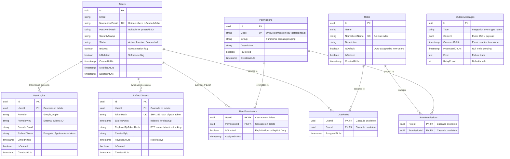
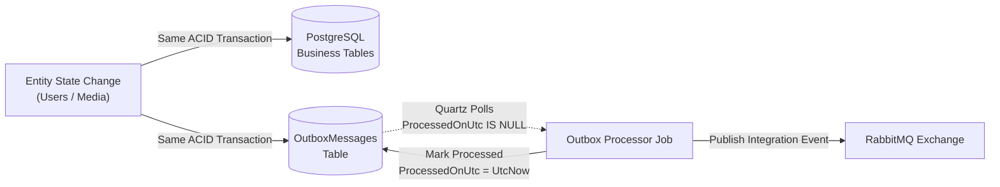

# 🗄️ ShuffleSeries Database Design Specification

Bu doküman, ShuffleSeries mikroservis ekosisteminin veri katmanını oluşturan **Identity** ve **Catalog** servislerinin ilişkisel veritabanı (PostgreSQL) mimarisini, ER (Entity-Relationship) diyagramlarını, tablo yapılarını, indeks stratejilerini ve uygulanan kurumsal tasarım desenlerini (design patterns) detaylandırmaktadır.

---

## 📌 Genel Veritabanı Mimarisi ve Prensipleri

ShuffleSeries platformu, mikroservis mimarisinin en temel ilkelerinden biri olan **Database-per-Service (Servis Başına Veritabanı)** modelini katı bir şekilde uygular:

1. **Bağımsız Şemalar ve Bounded Context İzolasyonu:** Her mikroservis (`Identity`, `Catalog`, `UserLibrary` vb.) yalnızca kendi PostgreSQL veritabanına ve şemasına erişir. Servisler arası doğrudan SQL JOIN veya veritabanı seviyesinde çapraz bağımlılık **kesinlikle yasaktır**.
2. **ACID Uyumluluğu ve Güvenilirlik:** İlişkisel veri tutarlılığı, yabancı anahtarlar (Foreign Keys), kaskad kuralları (`ON DELETE CASCADE` / `RESTRICT`) ve transaction izolasyonu ile PostgreSQL motoru üzerinde garanti altına alınır.
3. **UTC Zaman Damgası Standartı:** Tüm tarih-saat alanları zaman dilimi karmaşasını önlemek adına istisnasız `timestamp with time zone` (UTC) olarak saklanır (`CreatedAtUtc`, `ModifiedAtUtc`, `DeletedAtUtc`).
4. **Soft-Delete ve Denetim (Auditability):** `Shared.Core` tarafından sağlanan `ISoftDeletable` sözleşmesiyle fiziksel silme yerine mantıksal silme (`IsDeleted = true`) uygulanır. EF Core seviyesindeki Global Query Filter'lar (`e => !e.IsDeleted`) sayesinde atıl veya silinmiş veriler sorgulardan otomatik elenir.
5. **Transactional Outbox Deseni:** Veritabanı yazma operasyonu ile mesaj kuyruğuna (RabbitMQ) event fırlatma işlemi arasındaki dual-write problemini önlemek amacıyla her serviste yerel bir `OutboxMessages` tablosu bulunur.

---

## 🔑 1. ShuffleSeries.Identity Veritabanı Mimarisi

Identity Bounded Context; kimlik doğrulama (Authentication), yetkilendirme (Authorization), harici sosyal SSO entegrasyonları, misafir oturumları ve oturum güvenliğini (Refresh Token Rotation) yönetir.

### 1.1. Identity Entity-Relationship (ER) Diyagramı



---

### 1.2. Identity Veri Sözlüğü (Data Dictionary)

#### A. `Users` Tablosu
Sistemdeki tüm kullanıcı profillerini (misafirler, e-posta/şifre kullanıcıları ve sosyal SSO kullanıcıları) temsil eder.

| Kolon Adı | Veri Tipi | Nullable | Varsayılan | Açıklama / Kısıtlar |
| :--- | :--- | :--- | :--- | :--- |
| `Id` | `uuid` | Hayır | `gen_random_uuid()` | **Primary Key** |
| `Email` | `varchar(256)` | Hayır | - | Kullanıcı e-posta adresi |
| `NormalizedEmail`| `varchar(256)` | Hayır | - | Büyük harfe dönüştürülmüş e-posta. **Unique Partial Index:** `WHERE "IsDeleted" = false` |
| `PasswordHash` | `varchar(512)` | Evet | `NULL` | PBKDF2 (SHA-512) şifre özeti. Misafir ve doğrudan SSO girişlerinde `NULL` olabilir. |
| `SecurityStamp` | `varchar(64)` | Hayır | - | Kullanıcı şifresi veya yetkileri değiştiğinde güncellenen güvenlik mührü |
| `Status` | `varchar(32)` | Hayır | `'Active'` | Kullanıcı durumu (`Active`, `Inactive`, `Suspended`). B-Tree indeksli. |
| `IsGuest` | `boolean` | Hayır | `false` | Misafir oturumu bayrağı. Kayıtlı hesaba dönüştürüldüğünde (`ConvertFromGuest`) `false` olur. |
| `IsDeleted` | `boolean` | Hayır | `false` | Mantıksal silme bayrağı (Soft Delete). B-Tree indeksli. |
| `CreatedAtUtc` | `timestamp with time zone` | Hayır | - | Oluşturulma tarihi (UTC) |
| `CreatedBy` | `text` | Evet | `NULL` | Kaydı oluşturan aktör |
| `ModifiedAtUtc`| `timestamp with time zone` | Evet | `NULL` | Son güncellenme tarihi (UTC) |
| `ModifiedBy` | `text` | Evet | `NULL` | Son güncelleyen aktör |
| `DeletedAtUtc` | `timestamp with time zone` | Evet | `NULL` | Mantıksal silinme tarihi (UTC) |
| `DeletedBy` | `text` | Evet | `NULL` | Mantıksal silen aktör |

#### B. `Roles` Tablosu
Sistemdeki statik ve dinamik yetki gruplarını (`Guest`, `Standard`, `Premium`, `Admin`) modeller.

| Kolon Adı | Veri Tipi | Nullable | Açıklama / Kısıtlar |
| :--- | :--- | :--- | :--- |
| `Id` | `uuid` | Hayır | **Primary Key** |
| `Name` | `varchar(64)` | Hayır | Rol adı |
| `NormalizedName`| `varchar(64)`| Hayır | Normalleştirilmiş rol adı. **Unique Index**. |
| `Description` | `varchar(256)`| Hayır | Rol açıklaması |
| `IsDefault` | `boolean` | Hayır | Yeni kayıt olan kullanıcılara otomatik atanma bayrağı |
| `IsDeleted` | `boolean` | Hayır | Soft Delete bayrağı |
| `CreatedAtUtc` | `timestamp with time zone` | Hayır | Oluşturulma zamanı (UTC) |

#### C. `Permissions` Tablosu
Granüler işlem bazlı izin tanımlarını barındırır (`catalog:read`, `catalog:write`, `shuffle:unlimited` vb.).

| Kolon Adı | Veri Tipi | Nullable | Açıklama / Kısıtlar |
| :--- | :--- | :--- | :--- |
| `Id` | `uuid` | Hayır | **Primary Key** |
| `Code` | `varchar(128)`| Hayır | İzin anahtar kodu (örn: `catalog:movies:create`). **Unique Index**. |
| `Group` | `varchar(64)` | Hayır | Modül kategorisi (örn: `Catalog`, `Identity`, `Shuffle`) |
| `Description` | `varchar(256)`| Hayır | İznin yaptığı işi anlatan açıklama metni |
| `IsDeleted` | `boolean` | Hayır | Soft Delete bayrağı |
| `CreatedAtUtc` | `timestamp with time zone` | Hayır | Oluşturulma zamanı (UTC) |

#### D. `UserRoles`, `RolePermissions` ve `UserPermissions` (Yetki Kesişim Tabloları)
- **`UserRoles`**: Kompozit Primary Key `(UserId, RoleId)`. `Users` veya `Roles` silindiğinde `ON DELETE CASCADE`.
- **`RolePermissions`**: Kompozit Primary Key `(RoleId, PermissionId)`. `Roles` veya `Permissions` silindiğinde `ON DELETE CASCADE`.
- **`UserPermissions`**: Kompozit Primary Key `(UserId, PermissionId)`. `IsGranted (boolean)` kolonu içerir. Kullanıcıya özel izin verme (`true`) veya rolünden gelen izni özellikle kısıtlama/yasaklama (`false`) amacıyla **Policy-Based Access Control (PBAC)** katmanı olarak çalışır.

#### E. `RefreshTokens` Tablosu
OWASP API4 kurallarına tam uyumlu **Refresh Token Rotation (RTR)** mekanizmasını yönetir.

| Kolon Adı | Veri Tipi | Nullable | Açıklama / Kısıtlar |
| :--- | :--- | :--- | :--- |
| `Id` | `uuid` | Hayır | **Primary Key** |
| `UserId` | `uuid` | Hayır | `Users(Id)` ile ilişkili **Foreign Key** (`ON DELETE CASCADE`). B-Tree indeksli. |
| `TokenHash` | `varchar(256)`| Hayır | Plain token'ın SHA-256 hash'i. Veritabanı sızıntılarına karşı plaintext saklanmaz. **Unique Index**. |
| `ExpiresAtUtc` | `timestamp with time zone` | Hayır | Token son geçerlilik tarihi. Süresi dolan token'ları toplu temizlemek için B-Tree indeksli. |
| `ReplacedByTokenHash` | `varchar(256)` | Evet | Bu token yenilendiğinde üretilen yeni token'ın hash'i. **Partial Index:** `WHERE "ReplacedByTokenHash" IS NOT NULL`. Token hırsızlığı/tekrar kullanım (reuse detection) tespitinde kullanılır. |
| `CreatedByIp` | `varchar(64)` | Evet | Token'ı talep eden istemci IP adresi |
| `RevokedAtUtc` | `timestamp with time zone` | Evet | Token iptal edildiyse iptal tarihi |
| `IsDeleted` | `boolean` | Hayır | Soft Delete bayrağı |

#### F. `UserLogins` Tablosu
Harici OAuth2/OIDC kimlik sağlayıcılarını (Apple, Google) yönetir.

| Kolon Adı | Veri Tipi | Nullable | Açıklama / Kısıtlar |
| :--- | :--- | :--- | :--- |
| `Id` | `uuid` | Hayır | **Primary Key** |
| `UserId` | `uuid` | Hayır | `Users(Id)` ile ilişkili **Foreign Key** (`ON DELETE CASCADE`). B-Tree indeksli. |
| `Provider` | `varchar(64)` | Hayır | Sağlayıcı adı (`Google`, `Apple`) |
| `ProviderKey` | `varchar(256)`| Hayır | Sağlayıcıdan gelen benzersiz Subject ID (`sub`). |
| `ProviderEmail`| `varchar(256)`| Evet | Sağlayıcıdaki e-posta |
| `RefreshToken` | `varchar(1024)`| Evet | Apple Store Guideline 5.1.1 gereği hesap silmede Apple oturumunu iptal etmek için şifreli saklanan refresh token. |
| `LinkedAtUtc` | `timestamp with time zone` | Hayır | Hesabın bağlandığı an (UTC) |
| - | - | - | **Unique Composite Index:** `(Provider, ProviderKey)` |

---

### 1.3. Identity Mimarisi ve Tasarım Tercihleri ("Neden Bu Pattern?")

1. **Neden Hybrid RBAC + PBAC?:**
   Sadece RBAC (Role-Based) kullanılsaydı, örneğin tek bir kullanıcıya özel beta özelliği açmak veya bir kullanıcının yetkisini geçici olarak askıya almak için sonsuz sayıda yeni rol (rol enflasyonu) türetmek gerekirdi. `UserPermissions` tablosu ile kullanıcı bazında spesifik izinler ezilebilir (`IsGranted = true/false`). Çözümlenen efektif izinler JWT claim'lerine (`permissions: [...]`) gömülerek API Gateway katmanında veritabanına gitmeden sub-microsecond yetki doğrulaması yapılır.
2. **Neden In-Place Guest Elevation?:**
   Misafir kullanıcı (`IsGuest = true`) kayıtlı hesaba geçtiğinde (`POST /api/auth/convert-guest`), yeni bir `UserId` üretmek yerine mevcut kayıt yerinde güncellenir. Bu sayede downstream mikroservislerde (User Library, History, Tickets) yüzlerce satırlık veri taşıma (migration) maliyeti ve distributed transaction riski sıfıra indirilir.
3. **Neden RTR Reuse Detection?:**
   Bir Refresh Token kullanıldığında yenisi üretilir ve eski token'ın `ReplacedByTokenHash` alanına yeni hash yazılır. Eğer saldırgan daha önce kullanılmış bir token'ı tekrar sunarsa sistem bunu anında algılar, söz konusu kullanıcıya ait tüm token ailesini (`UserId` altındaki tüm oturumları) iptal eder ve Redis kara listesine yazarak saldırıyı bloke eder.

---

## 📦 2. ShuffleSeries.Catalog Veritabanı Mimarisi

Catalog Bounded Context; film, dizi, sezon, antoloji ve bağımsız bölümlerin hiyerarşik veri modelini, çoklu dil çevirilerini (Entity Translation Pattern), yayın platformlarını ve derin bağlantıları (Deep Linking) ile ruh hali (Mood) eşleştirmelerini barındıran **Tek Gerçeklik Kaynağıdır (Source of Truth)**.

### 2.1. Catalog Entity-Relationship (ER) Diyagramı

```mermaid
erDiagram
    Media ||--o{ MediaTranslations : "has localized content"
    Media ||--o{ MediaPlatforms : "available on (movies/series)"
    Platforms ||--o{ MediaPlatforms : "hosts media"
    Media ||--o{ MediaMoods : "categorized by vibe"
    Moods ||--o{ MediaMoods : "tags media"
    Moods ||--o{ MoodTranslations : "has localized names/tags"
    Media ||--o{ MediaGenres : "categorized by genre"
    Genres ||--o{ MediaGenres : "tags media"
    Genres ||--o{ GenreTranslations : "has localized names"
    Media ||--o{ Seasons : "contains (Series only)"
    Seasons ||--o{ Episodes : "contains"
    Episodes ||--o{ EpisodeTranslations : "has localized titles"
    Episodes ||--o{ EpisodePlatforms : "deep links per episode"
    Platforms ||--o{ EpisodePlatforms : "direct play stream"

    Media {
        uuid Id PK
        int MediaType "1=Movie, 2=Series (TPH Discriminator)"
        string ImdbId UK "Unique partial index where not null"
        double ImdbRating
        int ImdbVotes
        int ReleaseYear "Indexed"
        string PosterUrl "Vertical Hero OLED poster"
        string BackdropUrl "16:9 cinematic backdrop"
        int RuntimeMinutes "Movie specific"
        string Director "Movie specific"
        int SeriesType "Series specific: 1=Standard, 2=Episodic, 3=Seasonal"
        int TotalSeasons "Series specific"
        boolean IsDeleted "Soft delete flag"
        timestamp CreatedAtUtc
        timestamp ModifiedAtUtc
    }

    MediaTranslations {
        uuid Id PK
        uuid MediaId FK "Cascade on delete"
        string LanguageCode "tr, en, de"
        string Title "Indexed"
        string Overview "Max 2000 chars"
        string Tagline
        boolean IsDeleted
        timestamp CreatedAtUtc
    }

    Seasons {
        uuid Id PK
        uuid SeriesId FK "Cascade on delete"
        int SeasonNumber
        string Title "Nullable custom season title"
        boolean IsDeleted
        timestamp CreatedAtUtc
    }

    Episodes {
        uuid Id PK
        uuid SeasonId FK "Cascade on delete"
        int EpisodeNumber
        boolean IsStandalone "Flag for Episode Roulette (~45m)"
        int RuntimeMinutes
        double ImdbRating
        string ThumbnailUrl "OLED episode still frame"
        boolean IsDeleted
        timestamp CreatedAtUtc
    }

    EpisodeTranslations {
        uuid Id PK
        uuid EpisodeId FK "Cascade on delete"
        string LanguageCode "tr, en"
        string Title
        string Overview
        boolean IsDeleted
        timestamp CreatedAtUtc
    }

    Platforms {
        uuid Id PK
        string Name "Netflix, Prime Video, BluTV"
        string Slug UK "Unique url/filter slug"
        string LogoUrl "Active state vector logo"
        string InactiveLogoUrl "Monochrome inactive vector logo"
        string BaseWebUrl
        string BaseAppSchemeUrl "netflix://, primevideo://"
        int DisplayOrder "Indexed for UI ordering"
        boolean IsActive "Indexed"
        boolean IsDeleted
        timestamp CreatedAtUtc
    }

    MediaPlatforms {
        uuid Id PK
        uuid MediaId FK "Cascade on delete"
        uuid PlatformId FK "Restrict on delete"
        string WebUrl "Fallback browser URL"
        string AppSchemeUrl "Native mobile deep link"
        boolean IsDeleted
        timestamp CreatedAtUtc
    }

    EpisodePlatforms {
        uuid Id PK
        uuid EpisodeId FK "Cascade on delete"
        uuid PlatformId FK "Restrict on delete"
        string WebUrl "Direct episode stream URL"
        string AppSchemeUrl "Direct episode mobile deep link"
        boolean IsDeleted
        timestamp CreatedAtUtc
    }

    Moods {
        uuid Id PK
        string Code UK "Unique mood slug (beyin-yakanlar)"
        string AmbientColorHex "Hex color code (#FF4500)"
        string IconUrl "Vector icon asset"
        int DisplayOrder "Indexed"
        boolean IsActive "Indexed"
        boolean IsDeleted
        timestamp CreatedAtUtc
    }

    MoodTranslations {
        uuid Id PK
        uuid MoodId FK "Cascade on delete"
        string LanguageCode "tr, en"
        string Name "Localized mood name"
        string Description "Localized mood description"
        string VibeTags "Comma-separated tag list"
        boolean IsDeleted
        timestamp CreatedAtUtc
    }

    MediaMoods {
        uuid Id PK
        uuid MediaId FK "Cascade on delete"
        uuid MoodId FK "Restrict on delete"
        boolean IsDeleted
        timestamp CreatedAtUtc
    }

    Genres {
        uuid Id PK
        string Code UK "Unique genre slug (science-fiction)"
        int DisplayOrder "Indexed"
        boolean IsActive "Indexed"
        boolean IsDeleted
        timestamp CreatedAtUtc
    }

    GenreTranslations {
        uuid Id PK
        uuid GenreId FK "Cascade on delete"
        string LanguageCode "tr, en"
        string Name "Localized genre name"
        string Description "Optional localized genre description"
        boolean IsDeleted
        timestamp CreatedAtUtc
    }

    MediaGenres {
        uuid Id PK
        uuid MediaId FK "Cascade on delete"
        uuid GenreId FK "Restrict on delete"
        boolean IsDeleted
        timestamp CreatedAtUtc
    }

    OutboxMessages {
        uuid Id PK
        string Type "Integration event type name"
        jsonb Content "Event JSON payload"
        timestamp OccurredOnUtc
        timestamp ProcessedOnUtc "Indexed where null"
        text Error
        int RetryCount
    }
```



---

### 2.2. Catalog Veri Sözlüğü (Data Dictionary)

#### A. `Media` Tablosu (TPH - Table-per-Hierarchy)
Film (`Movie`) ve Dizi (`Series`) varlıklarını tek bir tabloda polimorfik olarak saklar.

| Kolon Adı | Veri Tipi | Nullable | Varsayılan | Açıklama / Kısıtlar |
| :--- | :--- | :--- | :--- | :--- |
| `Id` | `uuid` | Hayır | `gen_random_uuid()` | **Primary Key** |
| `MediaType` | `integer` | Hayır | - | **TPH Discriminator**: `1 = Movie`, `2 = Series`. |
| `ImdbId` | `varchar(20)` | Evet | `NULL` | IMDb ID'si (`tt1375666`). **Unique Partial Index:** `WHERE "IsDeleted" = false AND "ImdbId" IS NOT NULL`. |
| `ImdbRating` | `double precision` | Evet | `NULL` | IMDb puanı (1.0 - 10.0) |
| `ImdbVotes` | `integer` | Evet | `NULL` | IMDb oy adedi |
| `ReleaseYear` | `integer` | Hayır | - | Çıkış yılı. Filtreleme ve arama için B-Tree indeksli. |
| `PosterUrl` | `varchar(500)` | Hayır | - | OLED optimize dikey afiş URL'i |
| `BackdropUrl` | `varchar(500)` | Evet | `NULL` | 16:9 yatay görsel afiş URL'i |
| `RuntimeMinutes`| `integer` | Evet | `NULL` | **Movie özel kolonu:** Film süresi (dakika) |
| `Director` | `varchar(150)` | Evet | `NULL` | **Movie özel kolonu:** Yönetmen adı |
| `SeriesType` | `integer` | Evet | `NULL` | **Series özel kolonu:** `1 = Standard`, `2 = EpisodicAnthology`, `3 = SeasonalAnthology` |
| `TotalSeasons` | `integer` | Evet | `0` | **Series özel kolonu:** Toplam sezon adedi |
| `IsDeleted` | `boolean` | Hayır | `false` | Soft Delete bayrağı. B-Tree indeksli. |
| `CreatedAtUtc` | `timestamp with time zone` | Hayır | - | Oluşturulma tarihi (UTC) |
| `CreatedBy` | `text` | Evet | `NULL` | Oluşturan kullanıcı / servis |
| `ModifiedAtUtc`| `timestamp with time zone` | Evet | `NULL` | Son güncellenme tarihi (UTC) |
| `ModifiedBy` | `text` | Evet | `NULL` | Güncelleyen kullanıcı / servis |
| `DeletedAtUtc` | `timestamp with time zone` | Evet | `NULL` | Silinme tarihi (UTC) |
| `DeletedBy` | `text` | Evet | `NULL` | Silen kullanıcı / servis |

#### B. `MediaTranslations` Tablosu
Medya içeriklerinin dil bazlı metinsel verilerini saklar (Entity Translation Pattern).

| Kolon Adı | Veri Tipi | Nullable | Açıklama / Kısıtlar |
| :--- | :--- | :--- | :--- |
| `Id` | `uuid` | Hayır | **Primary Key** |
| `MediaId` | `uuid` | Hayır | `Media(Id)` ile ilişkili **Foreign Key** (`ON DELETE CASCADE`). B-Tree indeksli. |
| `LanguageCode` | `varchar(10)` | Hayır | IETF dil kodu (`tr`, `en`, `de`). B-Tree indeksli. |
| `Title` | `varchar(250)`| Hayır | Yerelleştirilmiş başlık. Arama ve sıralama için B-Tree indeksli. |
| `Overview` | `varchar(2000)`| Hayır | Yerelleştirilmiş konu özeti |
| `Tagline` | `varchar(500)`| Evet | Varsa yerelleştirilmiş slogan |
| `IsDeleted` | `boolean` | Hayır | Soft Delete bayrağı |
| - | - | - | **Unique Composite Index:** `(MediaId, LanguageCode) WHERE "IsDeleted" = false` |

#### C. `Seasons` Tablosu
Dizilere ait sezon bilgilerini modeller.

| Kolon Adı | Veri Tipi | Nullable | Açıklama / Kısıtlar |
| :--- | :--- | :--- | :--- |
| `Id` | `uuid` | Hayır | **Primary Key** |
| `SeriesId` | `uuid` | Hayır | `Media(Id)` ile ilişkili **Foreign Key** (`ON DELETE CASCADE`). |
| `SeasonNumber` | `integer` | Hayır | Sezon sırası (1, 2, ...) |
| `Title` | `varchar(150)`| Evet | Varsa sezona özel başlık (örn: antolojilerde alt başlık) |
| `IsDeleted` | `boolean` | Hayır | Soft Delete bayrağı |
| - | - | - | **Unique Composite Index:** `(SeriesId, SeasonNumber) WHERE "IsDeleted" = false` |

#### D. `Episodes` Tablosu (Bölüm Ruleti & Antoloji Odaklı)
Sezon altındaki bağımsız veya sıralı bölümleri saklar.

| Kolon Adı | Veri Tipi | Nullable | Varsayılan | Açıklama / Kısıtlar |
| :--- | :--- | :--- | :--- | :--- |
| `Id` | `uuid` | Hayır | `gen_random_uuid()` | **Primary Key** |
| `SeasonId` | `uuid` | Hayır | - | `Seasons(Id)` ile ilişkili **Foreign Key** (`ON DELETE CASCADE`). B-Tree indeksli. |
| `EpisodeNumber` | `integer` | Hayır | - | Bölüm numarası |
| `IsStandalone` | `boolean` | Hayır | `false` | **Bölüm Ruleti Bayrağı:** ~45 dakikalık bağlamdan bağımsız tüketilebilir bölümler için `true`. |
| `RuntimeMinutes`| `integer` | Evet | `NULL` | Bölüm süresi (dakika) |
| `ImdbRating` | `double precision`| Evet | `NULL` | Bölüm IMDb puanı |
| `ThumbnailUrl` | `varchar(500)`| Evet | `NULL` | Bölüm OLED ekran yakalama görseli |
| `IsDeleted` | `boolean` | Hayır | `false` | Soft Delete bayrağı. B-Tree indeksli. |
| - | - | - | - | **Unique Composite Index:** `(SeasonId, EpisodeNumber) WHERE "IsDeleted" = false` |
| - | - | - | - | **Kritik Partial Index (Rulet Motoru):** `CREATE INDEX ... ON "Episodes" ("IsStandalone") WHERE "IsStandalone" = true AND "IsDeleted" = false;` |

#### E. `EpisodeTranslations` Tablosu
Bölümlere ait başlık ve özet çevirilerini barındırır.

| Kolon Adı | Veri Tipi | Nullable | Açıklama / Kısıtlar |
| :--- | :--- | :--- | :--- |
| `Id` | `uuid` | Hayır | **Primary Key** |
| `EpisodeId` | `uuid` | Hayır | `Episodes(Id)` ile ilişkili **Foreign Key** (`ON DELETE CASCADE`). |
| `LanguageCode`| `varchar(10)` | Hayır | Dil kodu (`tr`, `en`) |
| `Title` | `varchar(250)`| Hayır | Bölüm başlığı (örn: *San Junipero*, *White Christmas*) |
| `Overview` | `varchar(2000)`| Evet | Bölüm özeti |
| `IsDeleted` | `boolean` | Hayır | Soft Delete bayrağı |
| - | - | - | **Unique Composite Index:** `(EpisodeId, LanguageCode) WHERE "IsDeleted" = false` |

#### F. `Platforms` Tablosu
İçeriklerin yayınlandığı dijital akış platformlarını (Netflix, Prime Video, BluTV vb.) modeller.

| Kolon Adı | Veri Tipi | Nullable | Varsayılan | Açıklama / Kısıtlar |
| :--- | :--- | :--- | :--- | :--- |
| `Id` | `uuid` | Hayır | `gen_random_uuid()` | **Primary Key** |
| `Name` | `varchar(100)`| Hayır | - | Platform adı |
| `Slug` | `varchar(100)`| Hayır | - | Benzersiz URL/filtre slug'ı (`netflix`). **Unique Partial Index:** `WHERE "IsDeleted" = false`. |
| `LogoUrl` | `varchar(500)`| Hayır | - | Aktif renkli vektör logo |
| `InactiveLogoUrl`| `varchar(500)`| Hayır | - | Pasif/seçilmemiş gri vektör logo |
| `BaseWebUrl` | `varchar(500)`| Hayır | - | Platform web ana adresi (`https://www.netflix.com`) |
| `BaseAppSchemeUrl`| `varchar(250)`| Evet | `NULL` | Mobil native şema (`netflix://`) |
| `DisplayOrder` | `integer` | Hayır | `0` | UI listeleme önceliği. B-Tree indeksli. |
| `IsActive` | `boolean` | Hayır | `true` | Platform aktiflik durumu. B-Tree indeksli. |
| `IsDeleted` | `boolean` | Hayır | `false` | Soft Delete bayrağı |

#### G. `MediaPlatforms` ve `EpisodePlatforms` Tabloları (Deep Linking)
- **`MediaPlatforms`**: Film ve dizilerin platformlardaki doğrudan sayfa bağlantılarını saklar.
  - `MediaId` (`Media(Id)` FK Cascade), `PlatformId` (`Platforms(Id)` FK Restrict), `WebUrl` (`varchar(1000)`), `AppSchemeUrl` (`varchar(500)`).
  - **Unique Composite Index:** `(MediaId, PlatformId) WHERE "IsDeleted" = false`.
- **`EpisodePlatforms`**: Antoloji dizilerinin bağımsız bölümlerine doğrudan atlama sağlayan bağlantıları saklar.
  - `EpisodeId` (`Episodes(Id)` FK Cascade), `PlatformId` (`Platforms(Id)` FK Restrict), `WebUrl` (`varchar(1000)`), `AppSchemeUrl` (`varchar(500)`).
  - **Unique Composite Index:** `(EpisodeId, PlatformId) WHERE "IsDeleted" = false`.

#### H. `Moods` ve `MoodTranslations` Tabloları (PRD 9 Temel Ruh Hali)
PRD'de belirtilen his odaklı 9 kategoriyi modeller (`kafa-dagitmalik`, `icini-isitanlar`, `beyin-yakanlar`, `zeka-oyunlari`, `gaza-getirenler`, `gerim-gerim-gerenler`, `dunyadan-uzaklas`, `gozyasi-garantili`, `ufkunu-genislet`).

- **`Moods`**:
  - `Id` (uuid PK), `Code` (`varchar(100)`, Unique Index), `AmbientColorHex` (`varchar(20)` - OLED arka plan rengi), `IconUrl` (`varchar(500)`), `DisplayOrder` (`integer`), `IsActive` (`boolean`), `IsDeleted` (`boolean`).
- **`MoodTranslations`**:
  - `Id` (uuid PK), `MoodId` (`Moods(Id)` FK Cascade), `LanguageCode` (`varchar(10)`), `Name` (`varchar(100)`), `Description` (`varchar(500)`), `VibeTags` (`varchar(500)`).
  - **Unique Composite Index:** `(MoodId, LanguageCode) WHERE "IsDeleted" = false`.
- **`MediaMoods`**:
  - `MediaId` (`Media(Id)` FK Cascade), `MoodId` (`Moods(Id)` FK Restrict).
  - **Unique Composite Index:** `(MediaId, MoodId) WHERE "IsDeleted" = false`.

#### I. `Genres` ve `GenreTranslations` Tabloları (Standart Film & Dizi Türleri)
Evrensel tür taksonomisini (Aksiyon, Komedi, Bilim Kurgu, Dram, Korku vb.) platform-bağımsız olarak saklar.

- **`Genres`**:
  - `Id` (uuid PK), `Code` (`varchar(100)`, Unique Index: `science-fiction`, `action`), `DisplayOrder` (`integer`), `IsActive` (`boolean`), `IsDeleted` (`boolean`).
  - **Unique Filtered Index:** `(Code) WHERE "IsDeleted" = false`.
- **`GenreTranslations`**:
  - `Id` (uuid PK), `GenreId` (`Genres(Id)` FK Cascade), `LanguageCode` (`varchar(10)`), `Name` (`varchar(100)`), `Description` (`varchar(500)`).
  - **Unique Composite Index:** `(GenreId, LanguageCode) WHERE "IsDeleted" = false`.

#### J. `MediaGenres` Tablosu (Medya - Tür Çoka-Çok İlişkisi)
Film ve dizilerin birden fazla türe bağlanmasını sağlar.

- **`MediaGenres`**:
  - `Id` (uuid PK), `MediaId` (`Media(Id)` FK Cascade), `GenreId` (`Genres(Id)` FK Restrict).
  - **Unique Composite Index:** `(MediaId, GenreId) WHERE "IsDeleted" = false`.
  - **Reverse FK Index:** `HasIndex(x => x.GenreId)` (Ters yönde hızlı arama ve tam tablo taramasını önleme kuralı).

---

### 2.3. Catalog Mimarisi ve Tasarım Tercihleri ("Neden Bu Pattern?")

1. **Neden TPH (Table-per-Hierarchy)?:**
   Film ve Dizi varlıkları için TPT (Table-per-Type) seçilseydi, her bir medya listeleme veya shuffle sorgusunda `Media` tablosu ile `Movies` ve `Series` tabloları arasında pahalı `LEFT JOIN` işlemleri çalıştırılacaktı. TPH sayesinde tüm ortak alanlar ve ayrıştırıcı kolonlar (`MediaType`) tek bir tabloda toplanarak sıfır JOIN ile maksimum disk I/O ve sorgu performansı elde edilmiştir.
2. **Neden Entity Translation Pattern?:**
   Tabloya `TitleTr`, `TitleEn`, `OverviewTr` gibi statik kolonlar eklemek (Naive yaklaşım), ileride Almanca, İspanyolca gibi yeni diller eklendiğinde tablo şemasında DDL değişiklikleri (`ALTER TABLE`) ve migration zorunluluğu doğuracaktı. Ayrı çeviri tabloları (`MediaTranslations`, `EpisodeTranslations`, `MoodTranslations`, `GenreTranslations`) sayesinde sistem, tek bir migration çalıştırmadan sonsuz sayıda dili dinamik olarak destekleyebilir.
3. **Neden Standalone Episode Filtreli Kısmi İndeks (Filtered Partial Index)?:**
   Veritabanında on binlerce dizi bölümü bulunabilir. Ancak Bölüm Ruleti modülü yalnızca `IsStandalone = true` olan bölümleri filtreler. Tüm tabloya indeks atmak yerine:
   ```sql
   CREATE INDEX "IX_Episodes_IsStandalone" ON "Episodes" ("IsStandalone") 
   WHERE "IsStandalone" = true AND "IsDeleted" = false;
   ```
   filtreli indeksi kullanılmıştır. Bu sayede indeks boyutu %90'ın üzerinde küçülmüş, RAM'de tutulan B-Tree düğümleri optimize edilmiş ve rulet motoru için mikro-saniye seviyesinde arama hızı sağlanmıştır.
4. **Neden Çift Seviyeli Deep Linking (Media & Episode Platforms)?:**
   Standart bir film için `netflix.com/title/123` bağlantısı yeterlidir. Ancak Bölüm Ruleti'nde kullanıcıya örneğin *Black Mirror: White Christmas* önerildiğinde, kullanıcının dizinin 1. Sezon 1. Bölümüne değil, doğrudan o bağımsız bölüme gitmesi gerekir. `EpisodePlatforms` tablosu bu kullanıcı deneyimi gereksinimini kusursuz şekilde karşılar.
5. **Neden LanguageCode Value Object ve EF Core Value Converter?:**
   Çoklu dil yönetiminde dil kodlarını (`LanguageCode`) salt `string` olarak taşımak DDD *Primitive Obsession* anti-pattern'ine yol açar ve geliştirici hatalarına (yazım hatası: `'tur'`, `'invalid'`) zemin hazırlar. Klasik `enum` ise Açık/Kapalı Prensibini (OCP) çiğner. `ShuffleSeries.Shared.Core.Domain.ValueObjects.LanguageCode` nesnesi; `LanguageCode.Turkish`, `LanguageCode.English` gibi tip güvenli sabitler ve `LanguageCode.From` doğrulama mantığı sunar. EF Core seviyesinde `HasConversion(x => x.Value, v => LanguageCode.From(v))` uygulanarak veritabanında kolon `character varying(10)` olarak küçük harfli standart ISO formatında saklanmaya devam eder, kompozit tekil indeksler (`MediaId, LanguageCode`) bozulmaz ve sıfır migration ile tam tip güvenliği sağlanır.
6. **Neden Dual-Taxonomy (Genre vs. Mood) ve Platform-Bağımsız Tür Mimarisi?:**
   Sektörde (TMDB, IMDb, Netflix) tür (`Genre`) içeriğin ne olduğunu (objektif: *Bilim Kurgu, Komedi, Korku*) tanımlarken; `Mood` izleyicinin ruh halini ve aradığı etkiyi (sübjektif: *Beyin Yakan, Kafa Dağıtmalık, Tırnak Yedirten*) modeller. Aynı türe ait yapımlar (örn. *Alien* vs *Interstellar* vs *Spaceballs*) taban tabana zıt ruh hallerine hitap eder; bu sebeple `Genre` ile `Mood` veritabanında doğrudan birbirine bağlanmaz, `Media` üzerinde iki bağımsız boyut olarak kesişir. Ayrıca `Genre` tablosu 3. parti sağlayıcı (TMDB) kimliklerinden arındırılarak platform-bağımsız (pure domain) tutulmuş; TMDB'nin 19 standart türü referans adlarıyla tohumlanarak dış servis eşleştirmelerinin adapter katmanında yönetilmesi güvenceye alınmıştır.

---

## 📨 3. Transactional Outbox Tablo Yapısı (`OutboxMessages`)

Dual-Write problemini engellemek amacıyla hem Identity hem de Catalog veritabanlarında `OutboxMessages` tablosu mevcuttur.



| Kolon Adı | Veri Tipi | Nullable | Varsayılan | Açıklama / Kısıtlar |
| :--- | :--- | :--- | :--- | :--- |
| `Id` | `uuid` | Hayır | `gen_random_uuid()` | **Primary Key** |
| `Type` | `varchar(255)` | Hayır | - | Entegrasyon event'inin tam CLR tipi |
| `Content` | `jsonb` | Hayır | - | Event'in JSON verisi (PostgreSQL native `jsonb`) |
| `OccurredOnUtc` | `timestamp with time zone` | Hayır | - | Event'in fırlatıldığı an. Sıralı okuma için B-Tree indeksli. |
| `ProcessedOnUtc`| `timestamp with time zone` | Evet | `NULL` | İşlenme tarihi. Henüz işlenmemişleri ultra hızlı çekmek için **Partial Index:** `WHERE "ProcessedOnUtc" IS NULL`. |
| `Error` | `text` | Evet | `NULL` | Hata fırlatıldıysa stack trace |
| `RetryCount` | `integer` | Hayır | `0` | Yeniden deneme sayısı (Max 3, sonra poison quarantine) |

---

## 🛠️ 4. Veritabanı Bakım ve Taşıma (Migration) Komutları

EF Core Code-First yaklaşımı ile hazırlanan veritabanı şemalarını yerel PostgreSQL üzerinde güncellemek için aşağıdaki komutlar kullanılır:

```bash
# Identity DB Migration Güncelleme
dotnet ef database update \
  --project ShuffleSeries.Identity/ShuffleSeries.Identity.Infrastructure \
  --startup-project ShuffleSeries.Identity/ShuffleSeries.Identity.Api

# Catalog DB Migration Güncelleme
dotnet ef database update \
  --project ShuffleSeries.Catalog/ShuffleSeries.Catalog.Infrastructure \
  --startup-project ShuffleSeries.Catalog/ShuffleSeries.Catalog.Api
```
